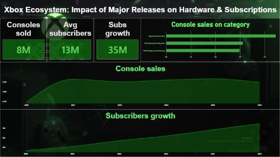

# 🎮 Xbox Ecosystem Strategy Analysis: Game Pass Ultimate & Hardware Economics (2020–2025)


An end-to-end analytics strategy exercise exploring how major game releases, Game Pass availability, console sales, and subscriber growth could fit together in a business narrative.

> **Data note:** The time series in this repository are synthetic and generated from explicit assumptions. The figures and patterns below are outputs of that model—not observed Xbox or Game Pass results, and not evidence of real-world causal effects.

---

## 📌 Dashboard Preview


---

## 📖 Executive Summary & Context

The project examines a strategic question: how might launch-window subscription access relate to console demand and subscriber growth, and what evidence would be needed to assess that relationship in the real market?

To demonstrate an end-to-end analytics workflow without claiming access to complete commercial sales or subscriber records, I generated daily time series for 2020–2025. The model includes chosen baselines, seasonality, release-window effects, and random variation. Its outputs help illustrate how assumptions flow into a data model, dashboard, and strategy discussion.

---

## 🎯 Modeled Outputs

The following figures describe this project's generated dataset only. They should not be interpreted as actual Xbox sales or subscriber metrics:

1. **Modeled pre-order window difference (+31.6%):**
   - The generated series show an average of **4,449 modeled console sales** in the pre-order-to-release window for the Day One group, versus a modeled control average of **3,044.5 units**.
   - This is a property of the scenario assumptions; it does not establish that Day One Game Pass access caused a real-world sales lift.
2. **Modeled hardware trajectory (~1.5M plateau):**
   - The generated cumulative series approaches a modeled plateau of roughly **1.5M units**. This reflects the chosen baseline and assumptions, not a measured Xbox hardware ceiling or total addressable market.
3. **Modeled subscriber trajectory (35M peak):**
   - The generated subscription series reaches a modeled peak of **35M**, with a **13M average baseline**. These are scenario outputs, not verified subscriber counts.

---

## 💡 Questions for Further Investigation

The dashboard suggests questions to test with reliable, documented real-world data—not policy conclusions:

- Do launch-window subscription offers change hardware purchase timing, total hardware demand, or neither?
- How do subscription access, full-price sales, expansions, and long-term engagement interact across different game types?
- What trade-offs would alternative access windows create for player experience, retention, and revenue?
- Which hardware positioning and multiplayer access models fit specific markets and customer segments?

Possible options—such as time-limited access, separating base-game and expansion access, or different seasonal access models—would need customer research, commercial data, and controlled evaluation before being recommended. No access restriction or progress gate is established by this synthetic analysis.

---

## 🛠 Tech Stack & Architecture

* **Data Generation & Processing:** Python (`pandas`, `numpy`)
* **Data Modeling:** Star Schema (Fact Tables: `fact_console_sales`, `fact_subscriptions`; Dimension Tables: `dim_games`, `dim_dates`)
* **Analytics & Visualization:** Power BI Desktop with custom DAX measures (`DIVIDE`, `CALCULATE`, `SAMEPERIODLASTYEAR`, `RANKX`).

---

## 📁 Repository Structure

```text
xbox-ecosystem-analytics/
├── assets/                  # Dashboard screenshots and slide previews
├── data/                    # Raw and processed datasets (CSV)
├── docs/                    # Full executive strategy presentation (PDF)
├── power_bi/                # Power BI (.pbix) report file and dax_measures.txt
├── scripts/                 # Python scripts for data ETL/generation
└── README.md                # Project documentation
```
